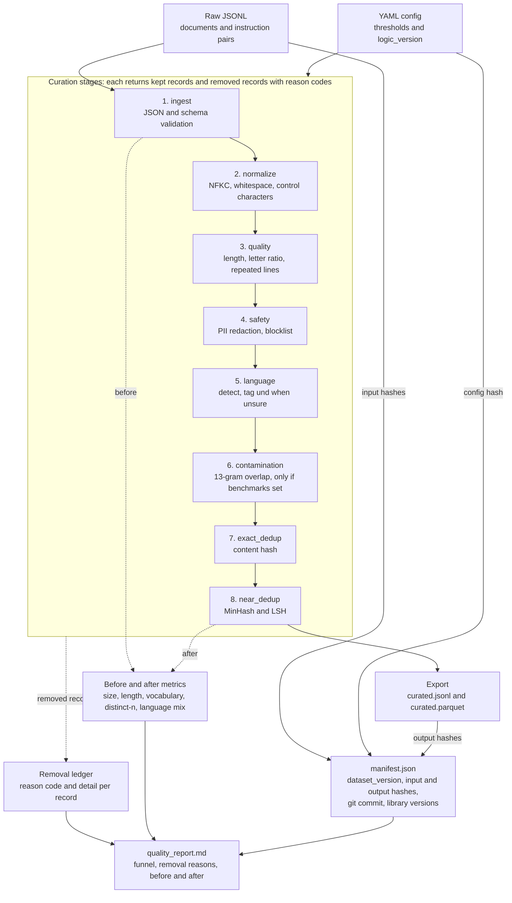

# Dataset Curation Pipeline

A Python pipeline that turns raw documents and instruction-response pairs into a
cleaned, deduplicated, audited training dataset. Every removed record carries a
reason code, every run writes a quality report, and every output has a
reproducible version ID.

## What it does

- Ingests JSONL documents and instruction-response pairs, validating the schema
  and routing malformed lines to a rejects list instead of crashing.
- Normalizes text (Unicode NFKC, whitespace, control characters) without
  damaging Indic scripts.
- Filters low-quality records with rules that differ for documents and
  instruction pairs.
- Redacts or drops PII (emails, Indian phone numbers, Aadhaar with Verhoeff
  checksum, PAN) and applies an optional blocklist.
- Detects language and tags records whose language cannot be determined
  reliably instead of guessing.
- Removes records that overlap benchmark test questions (13-gram match,
  GSM8K supported).
- Removes exact duplicates and near-duplicates (MinHash/LSH).
- Exports JSONL and Parquet, a manifest with provenance, and a Markdown
  quality report with per-stage counts and before/after metrics.

## Pipeline



| Order | Stage | Removes or does |
|---|---|---|
| 1 | `ingest` | Invalid JSON, non-objects, unknown shapes, schema failures |
| 2 | `normalize` | Cleans text; drops records that become empty |
| 3 | `quality` | Too short or long, low letter ratio (documents only), repeated lines |
| 4 | `safety` | Redacts or drops PII; blocklist terms |
| 5 | `language` | Removes confidently detected disallowed languages; tags the rest |
| 6 | `contamination` | Records sharing a 13-gram with a benchmark question (only if benchmarks are configured) |
| 7 | `exact_dedup` | Byte-identical content after normalization |
| 8 | `near_dedup` | MinHash/LSH similarity above a threshold |

Cheap filters run before MinHash, and PII is redacted before dedup so records
that differ only by an email address collapse into one.

## Design decisions

- **Stage contract.** Every stage returns kept records plus removed records
  with a reason code. After each stage the pipeline checks that no record
  disappeared without a reason and raises an error if one did.
- **Strict, hashed config.** Unknown config keys are errors. The config hash
  excludes file paths but includes `logic_version`, an integer bumped whenever
  a stage's behavior changes. It relies on that bump being made by hand;
  the manifest's git commit and output hashes are the backstop.
- **Dataset version** = hash of input file contents, config hash and benchmark
  file contents (when benchmarks are configured). The manifest also stores the
  output file hashes, the git commit, whether the tree was dirty, and library
  versions.
- **Determinism.** Same inputs and config produce byte-identical JSONL
  (tested, and confirmed on the Alpaca run).
- **Per-kind rules.** Instruction pairs and documents get different thresholds.
  An instruction record's language is judged on its prompt, not its answer.
- **Act only on trustworthy detections.** Short or low-confidence language
  detections are tagged `und` and kept, not guessed at.

## Quickstart

Requires Python 3.10+.

```bash
python -m venv .venv
source .venv/Scripts/activate        # Git Bash on Windows; use .venv/bin/activate elsewhere
pip install -e ".[dev,data]"
pytest -q                            # 32 tests

python scripts/fetch_alpaca.py       # Stanford Alpaca, ~52k instruction pairs
python scripts/fetch_gsm8k.py        # GSM8K test questions for the contamination check
python -m curation.pipeline --config configs/alpaca.yaml

python scripts/fetch_wiki.py         # 2,000 Wikipedia articles each in en, ta, hi
python -m curation.pipeline --config configs/wiki.yaml
```

Each run writes to its `output_dir`: `curated.jsonl`, `curated.parquet`,
`manifest.json` and `quality_report.md`. Reports from the committed runs are in
`docs/reports/`.

## Results

### Alpaca (English instruction pairs)

Run `f5e5c6383579`, config hash `180860fbdfa8`.

| Stage | In | Out | Removed | Notes |
|---|---|---|---|---|
| ingest | 52,002 | 51,974 | 28 | `schema_invalid`: records with an empty response |
| normalize | 51,974 | 51,974 | 0 | |
| quality | 51,974 | 51,974 | 0 | |
| safety | 51,974 | 51,974 | 0 | 21 records redacted (41 emails, 1 phone) |
| language | 51,974 | 51,974 | 0 | tagged 11,589 `en` and 40,385 `und` |
| contamination | 51,974 | 51,974 | 0 | 46,293 GSM8K 13-grams indexed; 1,921 records under 13 tokens cannot be checked |
| exact_dedup | 51,974 | 51,974 | 0 | |
| near_dedup | 51,974 | 51,972 | 2 | |

51,972 of 52,002 input lines survive (99.9%).

| Metric | Before | After |
|---|---|---|
| Records | 51,974 | 51,972 |
| Mean characters | 355.9 | 354.5 |
| Vocabulary | 46,289 | 46,236 |
| distinct-1 | 0.0151 | 0.0151 |
| distinct-2 | 0.2421 | 0.2421 |

Two things this result does and does not say. The final filters change very
little on Alpaca, but that is the outcome of tuning described below, not
evidence that the data is perfect. And 77.7% of Alpaca records have no
language label, because most prompts are too short for the detector to be
trusted. On this dataset the language stage is mostly a tagger.

### Wikipedia (2,000 articles each in English, Tamil, Hindi)

Run `b0ca2ba4fcfe`, config hash `2f9a16295667`. The contamination stage is
disabled for this run (no benchmarks configured).

| Stage | In | Out | Removed | Notes |
|---|---|---|---|---|
| ingest | 6,000 | 6,000 | 0 | |
| normalize | 6,000 | 6,000 | 0 | |
| quality | 6,000 | 5,988 | 12 | 6 `too_short`, 3 `high_line_repetition`, 3 `low_alpha_ratio` |
| safety | 5,988 | 5,988 | 0 | 6 records redacted (11 emails, 2 phones) |
| language | 5,988 | 5,987 | 1 | one Hindi article detected as Nepali; tagged 2,005 `en`, 1,985 `ta`, 1,961 `hi`, 36 `und` |
| exact_dedup | 5,987 | 5,987 | 0 | |
| near_dedup | 5,987 | 5,984 | 3 | templated district stubs |

| Metric | Before | After |
|---|---|---|
| Records | 6,000 | 5,984 |
| Mean characters | 11,024.0 | 11,005.6 |
| Vocabulary | 493,751 | 493,061 |
| distinct-1 | 0.0477 | 0.0476 |
| distinct-2 | 0.3992 | 0.3992 |

Wikipedia gives language ground truth, since each article comes from a known
edition. On an earlier configuration of this run (5,952 articles kept), the
detected label matched the edition for 1,975 of 1,978 English kept articles
(3 tagged `und`), 1,980 of 1,987 Tamil, and 1,953 of 1,987 Hindi. The Hindi
and Tamil mismatches were 6 and 2 labeled `en`, with the rest `und`, so
detection is usable on documents but not infallible. Some mismatches may be
articles that are mostly English text, which I did not check.

Wikipedia is clean and edited, so this run mainly tests whether the filters
wrongly remove good text. It does not show how well they catch junk.

## What reading real samples changed

The first version of the filters was written from assumptions about web text.
Running it on Alpaca and reading samples of the removed records showed it was
removing good data. Every fix below came from a specific record.

| First run on Alpaca | Removed | What samples showed | Fix |
|---|---|---|---|
| `low_alpha_ratio` | 258 | Phone formatting, matrices, regexes, number lists | Letter ratio applies to documents only |
| `high_line_repetition` | 202 | Input echoed in the answer, code, songs, JSON | Per-field check, short lines ignored, looser threshold for instruction pairs |
| `too_short` | 7 | Valid answers like `What is 3 + 4?` / `7` | Lower length floor for instruction pairs |
| `language_not_allowed` | 168 | English prompts labeled `af`, `it`, `ca`, `ro` | Judge the prompt, require 100+ chars on Alpaca, tag `und` instead of removing |
| Emails redacted | 94 | Mostly `example.com` addresses | Skip reserved test domains |
| Aadhaar redacted | 1 | A 16-digit card number matched on 12 digits | Reject matches inside longer digit runs |
| Phone redacted | 2 | A 10-digit PIN code | Bare numbers need a nearby keyword (call, phone, mobile) |

The first Alpaca run removed 676 records, most of them wrongly. The final run
removes 30. On Wikipedia, 20 long articles (Bangladesh, the American
Revolution, Batman) were removed by a 100,000 character limit, so the limit was
raised to 250,000 and the document repetition threshold from 0.3 to 0.5.

One lesson about the detector: `langdetect` reported confidence 1.00 on
three-word English inputs ("Albert Einstein", "Madam, I'm Adam"), so its
confidence score cannot separate good detections from bad ones on short text.

## Verification

- **Unit tests (32):** every input line ends up in the output or exactly one
  removal, stages chain, reasons are present, exports are byte-identical across
  runs, and the behaviors fixed above are locked in.
- **Planted-defect check** (`scripts/planted_defects.py`): 20 synthetic defects
  of each type are mixed into 40 clean Wikipedia articles, and the pipeline is
  run on the result.

| Defect | Caught | Note |
|---|---|---|
| Exact duplicate | 20/20 | |
| Near duplicate (one word changed) | 20/20 | |
| Symbol junk | 20/20 | |
| Looped line | 19/20 | The 20th was also removed, by `low_alpha_ratio` instead of the repetition filter |
| Too short | 20/20 | |
| Benchmark question appended | 20/20 | Real GSM8K questions |
| French text under an English-only config | 20/20 | |
| Email address | 20/20 | Redacted |

No clean base record was removed (0 of 40). With 20 trials per type, 20/20
supports only a lower bound of about 84% (95% Wilson interval). The defects
are synthetic and written with knowledge of the rules, so this measures recall
on planted defects, not on natural ones.

### Validation tooling and what was not done

`scripts/make_label_sheet.py` builds a blind, shuffled labeling sheet (removed
records grouped by filter, plus a random sample of kept records),
`scripts/label_cli.py` is a terminal labeler, and `scripts/score_labels.py`
computes per-filter precision with Wilson intervals and a miss rate on the kept
sample. The scorer was verified on synthetic labels only.
**Hand-labeled validation was not completed**, so this repository reports no
measured precision or recall on natural data. Filter behavior was checked by
reading samples of removed records, by the planted-defect test, and by the unit
tests.

## Limitations

- **Thresholds are tuned by reading samples, not by measured precision and
  recall.** They are starting points for other datasets, not validated values.
- **Language detection is weak on short text.** `langdetect` mislabels short
  English, and Hindi and Nepali are confused (one Hindi article was removed as
  Nepali). A better detector (fastText, lingua) would help.
- **Instruction language is judged on the prompt only.** A Tamil answer to an
  English prompt is tagged English.
- **Contamination detection is verbatim 13-gram overlap on benchmark
  questions.** It misses paraphrases and answer-only leaks. Only GSM8K is
  supported, and records under 13 tokens cannot be checked.
- **Near-duplicate detection runs on prompt and answer together**, so the same
  prompt with different answers is not caught. MinHash/LSH is probabilistic, so
  pairs near the threshold can go either way.
- **PII rules favor precision over recall.** A bare 10-digit phone number with no
  keyword nearby is not redacted, and fictional addresses at real providers are
  still redacted.
- **No filter for disambiguation or list-only pages**, which appear in the
  Wikipedia samples.
- **Long documents are not chunked.** The Wikipedia config raises the length
  limit instead.
- **Alpaca quirks:** some instructions contain the same input pasted twice, which
  is not specifically filtered, and at least one retained record reproduces
  song lyrics verbatim.
- **distinct-n is not a quality score.** It depends on corpus size and rises
  mechanically when duplicates are removed.
- **Scale:** tested on 52k short records and 6k long documents, in memory on one
  machine. The Parquet file hash is stable only for the same `pyarrow` version,
  so the JSONL hash is the canonical one.

## Repository layout

```
src/curation/   ingest, normalize, filters, safety, language, contamination,
                dedup, stats, export, provenance, report, pipeline
configs/        alpaca.yaml, wiki.yaml
scripts/        dataset fetchers, removal inspector, planted-defect check,
                validation tooling
tests/          32 tests: invariants and per-stage behavior
docs/reports/   final quality reports
```